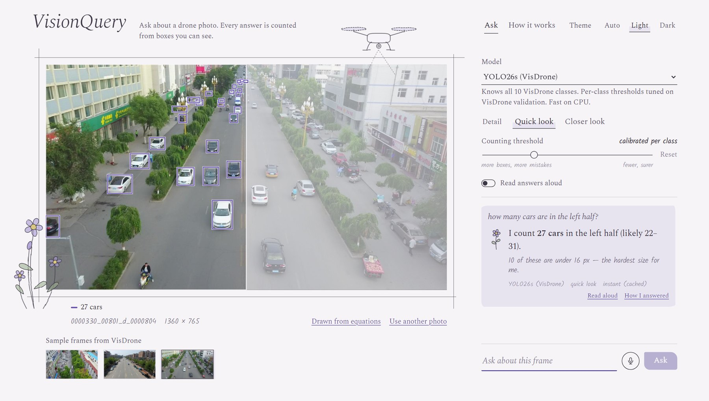
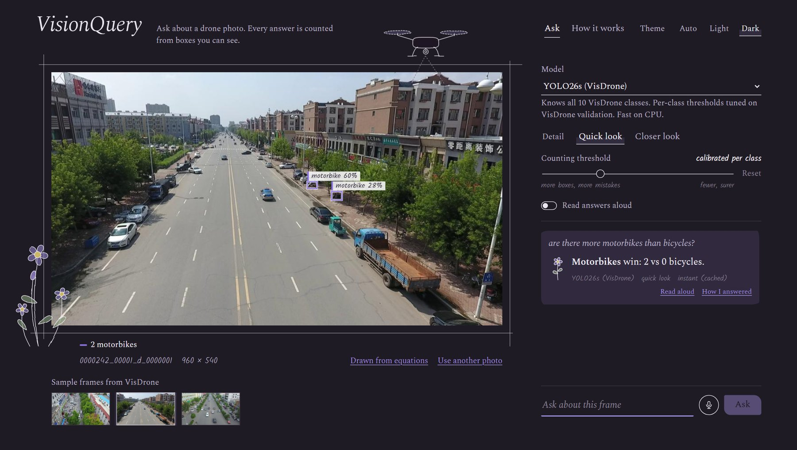
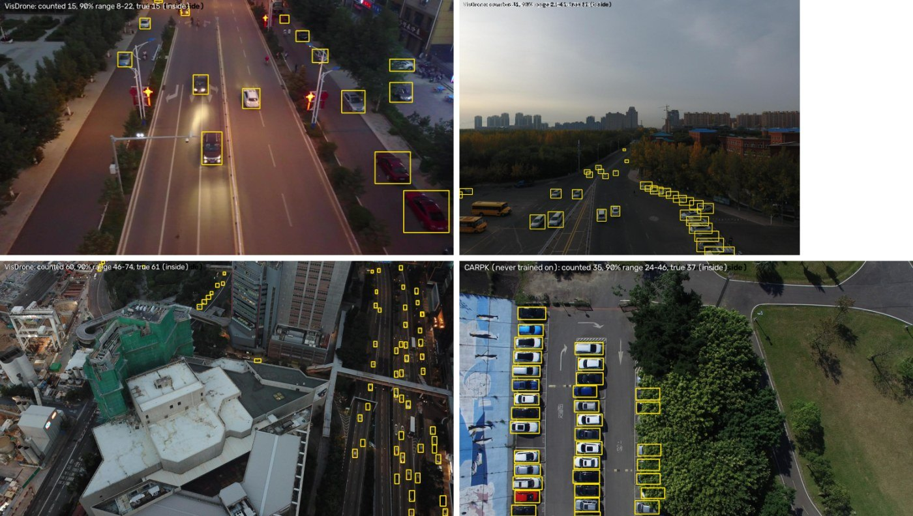
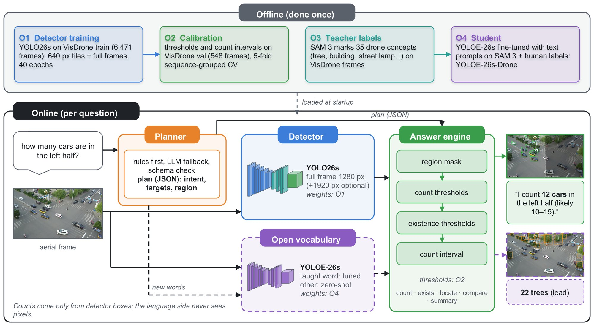
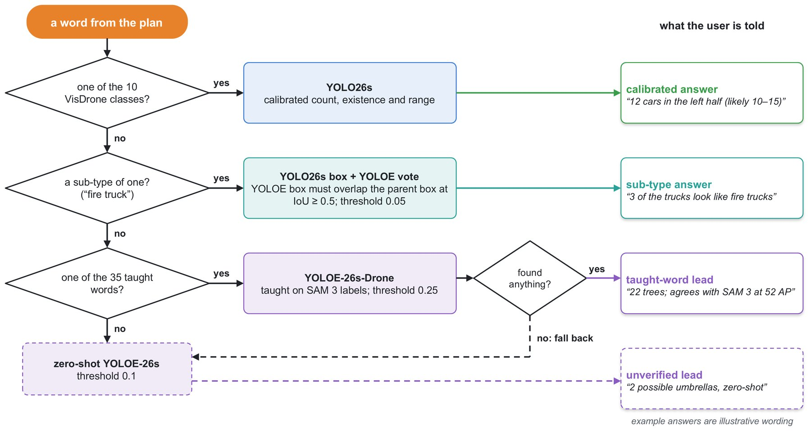
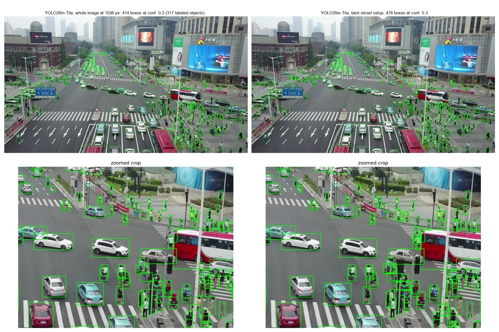
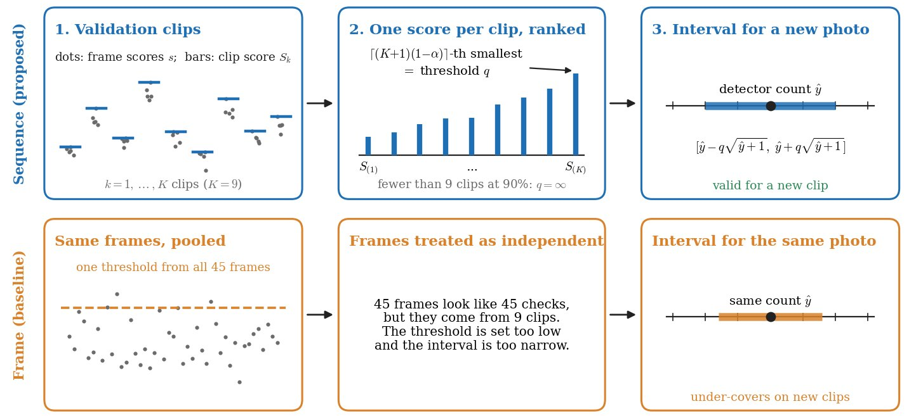

<div align="center">

# 🛸 VisionQuery

### Ask a drone photo a question. Get an answer you can check.

*"How many cars are in the left half?" → **"I count 27 cars in the left half (likely 22–31)"**, with every counted box drawn on the image.*

[](#-run-it-locally)
[](#-project-structure)
[](#-project-structure)
[](#-models)
[](#-run-it-with-docker)
[](LICENSE)



</div>

---

## ✨ What it does

VisionQuery is a web app for **counting small objects in drone imagery** (cars, pedestrians, bicycles, buses and more) by asking
questions in plain English, typed or spoken.

- 🎯 **Every answer is counted from detector boxes.** The language side never sees the pixels and never invents a number; you see exactly which boxes were counted.
- 📏 **Counts come with a calibrated range.** The strongest model attaches a 90% conformal interval, calibrated over whole drone videos rather than individual frames.
- 🔍 **Built for tiny objects.** Detectors are trained on image tiles and run on enlarged image slices, because most objects in drone footage are only a few pixels across.
- 🧭 **Understands regions and comparisons.** "left half", "top right corner", "more motorbikes than bicycles?", "any buses?"
- 🌱 **Honest about what it doesn't know.** Words outside the detector's ten classes ("trees", "fire trucks") go to an open-vocabulary model, and those answers are marked as leads, not counts.
- 🧪 **Pick your detector.** A model menu switches between detectors trained on VisDrone and on UAVDT.

<table>
<tr>
<td width="50%"></td>
<td width="50%"></td>
</tr>
<tr>
<td align="center"><sub><b>Comparisons</b>, in dark mode: "are there more motorbikes than bicycles?"</sub></td>
<td align="center"><sub><b>Counts with 90% ranges</b> on VisDrone and on CARPK, a parking-lot dataset the model never trained on</sub></td>
</tr>
</table>

---

## 🧠 How it works



1. **Plan.** A rule-based planner turns the question into a validated plan: *intent* (count, exists, locate, compare, summary), *target classes* and one of fifteen *regions*. An optional language model is consulted only when the rules find no target.
2. **Detect.** The selected detector finds every object it knows. The "sliced" setup runs on 512 px slices enlarged to 1280 px plus the whole image at 1536 px, drops boxes cut by slice borders and merges the rest.
3. **Answer.** The answer engine keeps the boxes in the requested region, applies per-class confidence thresholds tuned for counting on validation data, and writes the sentence.
4. **Attach a range.** For YOLO26m-Tile, each count carries a 90% conformal interval calibrated on whole validation videos, since frames from one flight are near-duplicates.

<details>
<summary><b>How a word is routed</b> (click to expand)</summary>
<br>


Known classes get the calibrated answer. Sub-types such as "fire truck" are answered from the parent-class boxes that the open-vocabulary model confirms. Thirty-five drone concepts taught with SAM 3 labels go to a fine-tuned YOLOE-26s; anything else goes to zero-shot YOLOE-26s and is marked as unverified.
</details>

<details>
<summary><b>Why slicing matters</b> (click to expand)</summary>
<br>


On the densest VisDrone validation image (317 labeled objects), slicing finds many more of the small people around the crossing.
</details>

<details>
<summary><b>Why calibrate over videos, not frames</b> (click to expand)</summary>
<br>


Treating near-duplicate frames as independent makes the interval look more reliable than it is. Calibrating over whole videos gives honest coverage.
</details>

---

## 📊 Results at a glance

| | |
|---|---|
| **Detection, VisDrone test-dev** | AP50 **0.540** with YOLO26m-Tile, sliced (0.541 ± 0.002 over three training seeds); 0.555 with the Ensemble |
| **Interval coverage, VisDrone test-dev (90% target)** | **92.6%** when calibrated over videos, against 87.7% when calibrated per frame |
| **Counting on unseen data (CARPK)** | mean absolute error of **2.18 cars** on a mean of 103.5 cars per image, without training on CARPK (car + van counted, one test parking lot) |
| **Against a vision-language model** | Qwen2.5-VL-7B answering directly errs more (MAE 9.22 vs 4.88 for the detector) and the gap grows with the number of objects |

**Where it is weaker:** per video, 82.0% of test videos reach the 90% target where about 90.8% are expected (not statistically significant, but real), and coverage drops in very crowded scenes, for tiny objects, and on UAVDT (72.3% for cars), where the VisDrone model over-counts. A few labeled frames from the new dataset do not fix that. The paper reports these limits in full.

---

## 🤖 Models

All weights are in [`weights/`](weights/). Pick one from the **Model** menu in the app.

| Model | Trained on | Classes | Inference | CPU time per new photo* |
|---|---|---|---|---|
| **YOLO26s** (default) | VisDrone | 10 | whole image 1280 px (or 1280 + 1920 px) | 0.26 s (0.93 s) |
| **YOLO26m-Tile** | VisDrone | 10 | sliced, with 90% conformal ranges | 16 s |
| **Ensemble**: YOLO26m-Tile + YOLOE-26m-FT | VisDrone | 10 | sliced, weighted box fusion | about twice YOLO26m-Tile |
| **YOLO26m-Tile** | UAVDT | car, truck, bus | whole image 1024 px | 0.71 s |
| **YOLO26s** | UAVDT | car, truck, bus | whole image 1024 px | 0.25 s |
| YOLOE-26s-Drone (open vocabulary) | VisDrone + SAM 3 labels | 35 taught concepts | whole image | |

<sub>*Mean over 10 VisDrone images on an Intel Core i5-12450H laptop CPU. Follow-up questions about the same photo are answered from a cache in milliseconds.</sub>

VisDrone classes: pedestrian, people, bicycle, car, van, truck, tricycle, awning-tricycle, bus, motor.

---

## 🚀 Run it locally

Requires Python 3.10+.

```bash
git clone https://github.com/<your-username>/VisionQuery.git
cd VisionQuery
pip install -e ".[sliced]"
visionquery serve            # then open http://127.0.0.1:8000
```

Or from the command line:

```bash
visionquery ask samples/0000330_00801_d_0000804.jpg "how many cars are in the left half?"
```

The first question about a word outside the ten classes downloads the zero-shot YOLOE model and its text encoder (about 270 MB) from Ultralytics.

## 🐳 Run it with Docker

```bash
docker build -t visionquery .
docker run -p 7860:7860 visionquery     # then open http://localhost:7860
```

The same image runs as a [Hugging Face Docker Space](https://huggingface.co/docs/hub/spaces-sdks-docker); [`deploy/huggingface/README.md`](deploy/huggingface/README.md) is the Space's config card.

<details>
<summary><b>Optional settings</b></summary>
<br>

Every key in [`configs/default.yaml`](configs/default.yaml) can be overridden with a `SKYQUERY_<KEY>` environment variable, for example `SKYQUERY_DEVICE=0` to use the first GPU.
For the optional language-model planner, set `HF_TOKEN` (Hugging Face router) or `SKYQUERY_LLM_API_KEY` with `SKYQUERY_LLM_BASE_URL` for any OpenAI-compatible API. Without a key, the rule-based planner answers everything it recognizes.
</details>

## 🛠️ Develop

```bash
pip install -e ".[sliced,eval,dev]"
pytest                                   # unit tests (skyquery is the Python package name)

cd frontend && npm install && npm run dev    # UI with hot reload on :5173, proxies /api to :8000
npm run build                                # writes frontend/dist, which the server serves at /
```

---

## 📁 Project structure

```
VisionQuery/
├── skyquery/            Python package: planner, detector, answer engine, calibration, API server, CLI
│   ├── planner/         rules, optional LLM, plan schema
│   ├── api/server.py    FastAPI app (serves the UI too)
│   ├── calibrate/       threshold and interval tuning on validation data
│   └── ovtrain/         open-vocabulary fine-tuning (SAM 3 teacher → YOLOE-26s student)
├── configs/             model registry, per-model thresholds and conformal intervals
├── weights/             trained detector weights
├── frontend/            React + TypeScript interface (dist/ is the built version)
├── reports/             evaluation summaries shown on the app's "How it works" page
├── samples/             three VisDrone frames to try
├── tests/               unit tests
├── deploy/huggingface/  Space config card
└── Dockerfile
```

---

## 👥 Team

Built as a final-year capstone project at the **School of Computer Science and Engineering (SCOPE), VIT-AP University**.

**Reet Mishra · Chinmayi Ajay Rajani · Isha Syed · Arsheen Aftab Inamdar**
Supervised by **Dr. Tauseef Khan**

A paper describing the framework and its evaluation is in preparation.

## 🙏 Acknowledgements

- Datasets: [VisDrone2019-DET](https://github.com/VisDrone/VisDrone-Dataset), [UAVDT](https://sites.google.com/view/grli-uavdt/), [CARPK](https://lafi.github.io/LPN/). The three sample frames are from VisDrone and are included for demonstration only.
- Detectors: [Ultralytics YOLO26 and YOLOE](https://github.com/ultralytics/ultralytics). Slicing utilities: [SAHI](https://github.com/obss/sahi). Box fusion: [ensemble-boxes](https://github.com/ZFTurbo/Weighted-Boxes-Fusion).
- Open-vocabulary teacher labels: SAM 3.

## 📄 License

[GNU AGPL-3.0](LICENSE), matching Ultralytics. If you run a modified version as a public service, you must publish its source.
The model weights were trained on VisDrone and UAVDT, which are licensed for academic, non-commercial use, so use them for research and education only.
